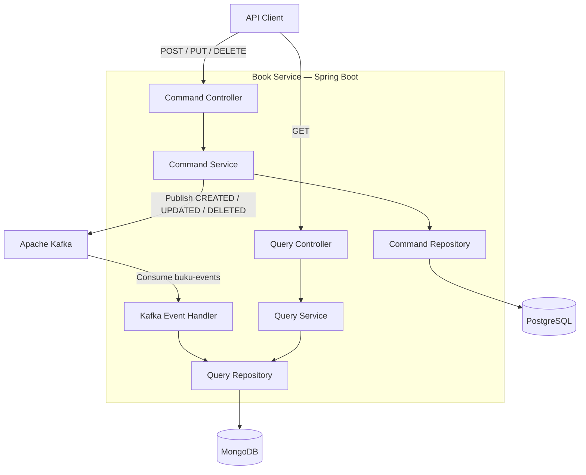

# 📚 Library Management System — Microservices Architecture

A library management system built with **Java, Spring Boot, PostgreSQL, MongoDB, and Apache Kafka**, implementing the **Command Query Responsibility Segregation (CQRS)** pattern and event-driven communication.

The Book Service separates write operations from read operations. PostgreSQL acts as the primary data store for commands, while MongoDB maintains a read-optimized representation of book data. Apache Kafka transports events between the two sides, allowing the read model to be updated asynchronously.

## Table of Contents

- [Overview](#overview)
- [Key Features](#key-features)
- [Technology Stack](#technology-stack)
- [System Architecture](#system-architecture)
- [CQRS Implementation](#cqrs-implementation)
- [Data Flow](#data-flow)
- [API Documentation](#api-documentation)
- [Data Models](#data-models)
- [Project Structure](#project-structure)
- [Prerequisites](#prerequisites)
- [Configuration](#configuration)
- [Installation and Running](#installation-and-running)
- [Testing the API](#testing-the-api)
- [Important Design Considerations](#important-design-considerations)
- [Current Limitations](#current-limitations)

---

## Overview

The project explores how a library system can use microservice-oriented design principles to separate responsibilities, manage data through specialized storage systems, and propagate changes asynchronously through an event broker.

The Book Service supports the following operations:

- Create book records.
- Update existing book records.
- Delete book records.
- Retrieve all books.
- Retrieve a book by its ID.
- Publish book lifecycle events to Apache Kafka.
- Consume events and synchronize the read model in MongoDB.

The implementation uses CQRS to separate the **command model**, responsible for changing data, from the **query model**, responsible for retrieving data.

### Why This Architecture?

In a conventional CRUD application, read and write operations commonly use the same model and database. This project explores a different approach by separating the two responsibilities.

The intended benefits include:

- **Separation of concerns:** command and query logic are implemented independently.
- **Asynchronous processing:** Kafka decouples event publication from read-model synchronization.
- **Read optimization:** MongoDB stores a document r inepresentationtended for query operations.
- **Technology flexibility:** PostgreSQL provides relational persistence, while MongoDB provides document-oriented persistence.
- **Independent evolution:** the command and query models can evolve according to their respective responsibilities.

These are architectural benefits the design aims to provide. Actual scalability, reliability, and performance depend on deployment, configuration, and implementation details.

---

## Key Features

### 1. Book Management

The command API provides endpoints for creating, updating, and deleting books.

Each book contains information such as its title, author, publisher, publication year, customer email, and availability status.

### 2. Separate Read and Write Models

The application uses two distinct models:

- `BukuCommand`: a JPA entity persisted in PostgreSQL.
- `BukuQuery`: a MongoDB document used to retrieve book data.

This separation is the foundation of the CQRS implementation.

### 3. Event-Driven Communication

After a successful database operation, the command service publishes a corresponding event to Kafka.

The event handler consumes messages from the `buku-events` topic and updates the MongoDB read model.

The supported event types are:

- `CREATED`
- `UPDATED`
- `DELETED`

### 4. Data Validation

The command model uses Jakarta Bean Validation annotations to validate incoming data.

Examples include:

- Book title must not be blank.
- Author must not be blank.
- Publisher must not be blank.
- Publication year must not be blank.
- Customer email must not be blank and must have a valid email format.

The command controller invokes validation through `@Valid`.

### 5. Containerized Kafka Infrastructure

Docker Compose defines the infrastructure needed for local Kafka development:

- Apache Kafka broker.
- Apache ZooKeeper.
- Kafdrop web interface for inspecting Kafka topics and messages.

---

## Technology Stack

| Category                      | Technology                         | Responsibility                                                                                                    |
| ----------------------------- | ---------------------------------- | ----------------------------------------------------------------------------------------------------------------- |
| Programming language          | Java 17                            | Implements the application's business logic.                                                                      |
| Backend framework             | Spring Boot 3.5.5                  | Provides application configuration, dependency injection, and web service infrastructure.                         |
| Build tool                    | Maven                              | Manages dependencies and builds the application.                                                                  |
| REST API                      | Spring Web                         | Exposes HTTP endpoints for book commands and queries.                                                             |
| Write database                | PostgreSQL                         | Stores the authoritative command-side book records.                                                               |
| Write persistence             | Spring Data JPA                    | Maps Java entities to relational database records.                                                                |
| Read database                 | MongoDB                            | Stores the query-side book documents.                                                                             |
| Read persistence              | Spring Data MongoDB                | Provides repository operations for the MongoDB read model.                                                        |
| Message broker                | Apache Kafka                       | Transports book lifecycle events asynchronously.                                                                  |
| Kafka integration             | Spring for Apache Kafka            | Provides Kafka producers, consumers, listeners, and message serialization.                                        |
| JSON serialization            | Jackson                            | Supports JSON message serialization and deserialization.                                                          |
| Validation                    | Jakarta Bean Validation            | Validates command request data.                                                                                   |
| Boilerplate reduction         | Lombok                             | Generates constructors, getters, setters, and other common methods.                                               |
| Health and monitoring support | Spring Boot Actuator               | Provides application monitoring capabilities when configured.                                                     |
| Service discovery dependency  | Spring Cloud Netflix Eureka Client | Provides Eureka client integration; registration requires additional configuration and a reachable Eureka server. |
| Containerization              | Docker                             | Packages the Java application into a container image.                                                             |
| Local infrastructure          | Docker Compose                     | Starts Kafka, ZooKeeper, and Kafdrop together.                                                                    |
| Kafka monitoring UI           | Kafdrop                            | Provides a browser-based interface for inspecting Kafka.                                                          |

### Database Responsibilities

**PostgreSQL — Command Side**

PostgreSQL stores the authoritative records used by create, update, and delete operations.

The `BukuCommandRepository` extends `JpaRepository<BukuCommand, String>`, allowing the application to use Spring Data JPA for database access.

**MongoDB — Query Side**

MongoDB stores the read model as documents in the `buku` collection.

The `BukuQueryRepository` extends `MongoRepository<BukuQuery, String>`, allowing the query service to retrieve documents without accessing the PostgreSQL command repository directly.

**Apache Kafka — Event Transport**

Kafka carries book lifecycle events from the command service to the event handler.

The event handler uses those events to update or delete the corresponding MongoDB documents.

---

## System Architecture

The current implementation follows a CQRS and event-driven architecture within the Book Service.



### Architecture Components

#### 1. Command Controller

Class: `BukuCommandController`

Base path:

`/api/buku/command`

Responsibilities:

- Accept HTTP requests that modify book data.
- Validate incoming request bodies.
- Pass operations to the command service.
- Return HTTP responses to the client.

The controller does not directly perform database operations.

#### 2. Command Service

Class: `BukuCommandService`

Responsibilities:

- Execute create, update, and delete operations.
- Generate UUIDs for newly created books.
- Set creation and processing timestamps.
- Persist changes through the command repository.
- Publish events to Kafka after database operations.

This component contains the primary write-side business logic.

#### 3. Command Repository

Class: `BukuCommandRepository`

Persistence technology: Spring Data JPA.

Database: PostgreSQL.

The repository provides database operations for the `BukuCommand` entity.

#### 4. Apache Kafka

Topic: `buku-events`

Kafka acts as the messaging layer between the command-side operations and the read-model synchronization process.

The producer publishes events, while the consumer processes them asynchronously.

#### 5. Event Handler

Class: `BukuEventHandler`

Responsibilities:

- Listen for events from `buku-events`.
- Ignore events that have a missing ID or event type.
- Convert create and update events into `BukuQuery` documents.
- Save or update documents in MongoDB.
- Delete MongoDB documents when a delete event arrives.

#### 6. Query Service

Class: `BukuQueryService`

Responsibilities:

- Retrieve all book documents.
- Retrieve a book by ID.
- Return query results to the query controller.

The query service accesses MongoDB through `BukuQueryRepository`.

#### 7. Query Controller

Class: `BukuQueryController`

Base path:

`/api/buku/query`

Responsibilities:

- Expose read-only HTTP endpoints.
- Delegate queries to the query service.
- Return book records to the client.

---

## CQRS Implementation

CQRS stands for **Command Query Responsibility Segregation**.

The principle is to separate operations that change data from operations that retrieve data.

### Command Side

The command side handles state-changing operations:

- Create a book.
- Update a book.
- Delete a book.

Its primary model is `BukuCommand`, which is mapped to a PostgreSQL table named `buku`.

The command side also publishes events describing the changes.

### Query Side

The query side handles data retrieval:

- Retrieve all books.
- Retrieve a book by ID.

Its primary model is `BukuQuery`, which is mapped to the MongoDB collection `buku`.

The query model is populated by consuming Kafka events.

### Why Use Separate Models?

The command and query models have different responsibilities.

| Aspect              | Command Model              | Query Model                |
| ------------------- | -------------------------- | -------------------------- |
| Java class          | `BukuCommand`              | `BukuQuery`                |
| Database            | PostgreSQL                 | MongoDB                    |
| Persistence API     | Spring Data JPA            | Spring Data MongoDB        |
| Main responsibility | Modify book records        | Retrieve book records      |
| Data updates        | Through command operations | Through consumed events    |
| Event handling      | Publishes lifecycle events | Reacts to lifecycle events |

The separation means that query operations do not need to read directly from the command repository.

However, PostgreSQL and MongoDB are not automatically kept consistent by sharing a transaction. The application relies on asynchronous event processing to propagate changes between the two sides.

This introduces **eventual consistency**: after a successful write, the updated record may take some time to appear in the query API.

---

## Data Flow

### 1. Create a Book

Endpoint:

`POST /api/buku/command`

The request follows this sequence:

1. The client sends a JSON request containing book information.
2. `BukuCommandController` receives the request.
3. `@Valid` triggers validation of the `BukuCommand` request body.
4. The controller calls `BukuCommandService.createBuku()`.
5. The service generates a UUID for the book and sets its creation timestamp.
6. `BukuCommandRepository` saves the book to PostgreSQL.
7. The service sets the event type to `CREATED`.
8. The service publishes the event to Kafka's `buku-events` topic.
9. `BukuEventHandler` consumes the event.
10. The handler converts the event payload into a `BukuQuery` document.
11. `BukuQueryRepository` saves the document to MongoDB.
12. Subsequent query requests can retrieve the book from MongoDB after the read model has been updated.

Simplified flow:

```text
Client
  |
  | POST /api/buku/command
  v
BukuCommandController
  |
  v
BukuCommandService
  |
  v
BukuCommandRepository
  |
  v
PostgreSQL
  |
  | Publish CREATED event
  v
Kafka: buku-events
  |
  | Consume event
  v
BukuEventHandler
  |
  v
BukuQueryRepository
  |
  v
MongoDB
```

The HTTP create operation returns the saved command model with HTTP `201 Created`.

**Important:** The Kafka publication is asynchronous. The current implementation does not guarantee that the MongoDB read model has been updated before the create response is returned.

### 2. Update a Book

Endpoint:

`PUT /api/buku/command/{id}`

The update flow is:

1. The client sends the book ID and updated book information.
2. The command controller receives the request.
3. The command service searches for the existing book in PostgreSQL.
4. If the record exists, the service updates the relevant fields.
5. The service sets `processedAt` to the current timestamp.
6. The updated record is saved to PostgreSQL.
7. The service sets the event type to `UPDATED`.
8. The service publishes the updated record to Kafka.
9. The event handler consumes the event.
10. The handler converts the event into a `BukuQuery` document.
11. MongoDB saves the document using the same ID, updating the existing record or inserting it if it does not exist.

```text
Client
  |
  | PUT /api/buku/command/{id}
  v
Command Controller
  |
  v
Command Service
  |
  | Find and update record
  v
PostgreSQL
  |
  | Publish UPDATED event
  v
Kafka
  |
  v
BukuEventHandler
  |
  v
MongoDB read model updated
```

The update endpoint returns HTTP `200 OK` when the command service completes successfully.

### 3. Delete a Book

Endpoint:

`DELETE /api/buku/command/{id}`

The delete flow is:

1. The client sends a delete request containing the book ID.
2. The command service checks whether the ID exists in PostgreSQL.
3. If the record does not exist, the service throws an exception.
4. If the record exists, it is deleted from PostgreSQL.
5. The service creates a deletion event with the book ID and event type `DELETED`.
6. The service publishes the event to Kafka.
7. The event handler consumes the event.
8. The handler deletes the corresponding document from MongoDB.

```text
Client
  |
  | DELETE /api/buku/command/{id}
  v
BukuCommandController
  |
  v
BukuCommandService
  |
  | Delete record
  v
PostgreSQL
  |
  | Publish DELETED event
  v
Kafka
  |
  v
BukuEventHandler
  |
  | Delete document
  v
MongoDB
```

The command controller returns HTTP `200 OK` with a success message when the service completes successfully.

Because the command-side deletion and the MongoDB deletion occur separately, there may be a short period during which the query model still contains the deleted book.

### 4. Retrieve All Books

Endpoint:

`GET /api/buku/query`

The read flow is:

1. The client sends a GET request.
2. `BukuQueryController` calls `BukuQueryService.getAllBukus()`.
3. The query service calls `BukuQueryRepository.findAll()`.
4. Spring Data MongoDB retrieves documents from the `buku` collection.
5. The controller returns the results with HTTP `200 OK`.

```text
Client
  |
  | GET /api/buku/query
  v
BukuQueryController
  |
  v
BukuQueryService
  |
  v
BukuQueryRepository
  |
  v
MongoDB
  |
  v
JSON Response
```

This query path does not retrieve data directly from PostgreSQL.

### 5. Retrieve a Book by ID

Endpoint:

`GET /api/buku/query/{id}`

The flow is:

1. The client sends the requested book ID.
2. The query controller passes the ID to the query service.
3. The query service calls `BukuQueryRepository.findById(id)`.
4. If the document exists, it is returned to the client.
5. If it does not exist, the service throws an exception.

The controller returns HTTP `200 OK` when a document is found.

The exact HTTP response for exceptions depends on the application's exception-handling configuration. A dedicated exception handler would make error responses more consistent.

---

## API Documentation

The following endpoints are defined in the current Book Service controllers.

### Command API

Base path: `/api/buku/command`

| Method   | Endpoint                 | Description   | Success Response |
| -------- | ------------------------ | ------------- | ---------------- |
| `POST`   | `/api/buku/command`      | Create a book | `201 Created`    |
| `PUT`    | `/api/buku/command/{id}` | Update a book | `200 OK`         |
| `DELETE` | `/api/buku/command/{id}` | Delete a book | `200 OK`         |

### Query API

Base path: `/api/buku/query`

| Method | Endpoint               | Description           | Success Response |
| ------ | ---------------------- | --------------------- | ---------------- |
| `GET`  | `/api/buku/query`      | Retrieve all books    | `200 OK`         |
| `GET`  | `/api/buku/query/{id}` | Retrieve a book by ID | `200 OK`         |

The actual host and port depend on the application's runtime configuration.

### Create a Book

```http
POST /api/buku/command
Content-Type: application/json
```

Example request:

```json
{
  "judul": "Clean Code",
  "pengarang": "Robert C. Martin",
  "penerbit": "Prentice Hall",
  "tahunTerbit": "2008",
  "customerEmail": "reader@example.com",
  "status": "TERSEDIA"
}
```

The `id` and `createdAt` fields are generated or initialized by the command-side implementation.

The `status` field accepts values defined in `BukuStatus`:

- `TERSEDIA`
- `DIPINJAM`

Example success response structure:

```json
{
  "id": "generated-uuid",
  "judul": "Clean Code",
  "pengarang": "Robert C. Martin",
  "penerbit": "Prentice Hall",
  "tahunTerbit": "2008",
  "customerEmail": "reader@example.com",
  "status": "TERSEDIA",
  "createdAt": "2026-10-27T10:00:00",
  "processedAt": null,
  "eventType": "CREATED"
}
```

The timestamp and generated ID are illustrative. The actual values depend on the request execution time.

### Update a Book

```http
PUT /api/buku/command/{id}
Content-Type: application/json
```

Example request:

```json
{
  "judul": "Clean Code — Revised",
  "pengarang": "Robert C. Martin",
  "penerbit": "Prentice Hall",
  "tahunTerbit": "2008",
  "customerEmail": "reader@example.com",
  "status": "DIPINJAM"
}
```

Replace `{id}` with the UUID of an existing book.

### Delete a Book

```http
DELETE /api/buku/command/{id}
```

Example response:

```text
Buku berhasil dihapus
```

### Retrieve All Books

```http
GET /api/buku/query
```

The response is a JSON array of book documents retrieved from MongoDB.

### Retrieve a Book by ID

```http
GET /api/buku/query/{id}
```

Replace `{id}` with the ID of a book in the MongoDB read model.

---

## Data Models

### BukuCommand

File: `model/BukuCommand.java`

`BukuCommand` represents the write-side entity.

It is mapped to the PostgreSQL table named `buku` using JPA.

| Field           | Type            | Description                                                           |
| --------------- | --------------- | --------------------------------------------------------------------- |
| `id`            | `String`        | Book identifier, generated as a UUID on creation.                     |
| `judul`         | `String`        | Book title; required.                                                 |
| `pengarang`     | `String`        | Book author; required.                                                |
| `penerbit`      | `String`        | Publisher; required.                                                  |
| `tahunTerbit`   | `String`        | Publication year; required.                                           |
| `customerEmail` | `String`        | Customer email; required and validated as an email address.           |
| `status`        | `BukuStatus`    | Book availability status.                                             |
| `createdAt`     | `LocalDateTime` | Creation timestamp.                                                   |
| `processedAt`   | `LocalDateTime` | Timestamp set when a book is updated.                                 |
| `eventType`     | `EventType`     | Event type used for Kafka publication; excluded from JPA persistence. |

`EventType` defines the following values:

```java
public enum EventType {
    CREATED,
    UPDATED,
    DELETED
}
```

### BukuQuery

File: `model/BukuQuery.java`

`BukuQuery` represents the read-side document.

It is mapped to the MongoDB collection named `buku`.

The document contains the book's ID, title, author, publisher, publication year, customer email, status, and timestamps.

The class also provides a constructor that copies the relevant fields from `BukuCommand`:

```java
public BukuQuery(BukuCommand command) {
    this.id = command.getId();
    this.judul = command.getJudul();
    this.pengarang = command.getPengarang();
    this.penerbit = command.getPenerbit();
    this.tahunTerbit = command.getTahunTerbit();
    this.customerEmail = command.getCustomerEmail();
    this.status = command.getStatus();
    this.createdAt = command.getCreatedAt();
    this.processedAt = command.getProcessedAt();
}
```

This conversion allows the Kafka event handler to transform command-side event data into the query-side representation.

### BukuStatus

File: `model/BukuStatus.java`

```java
public enum BukuStatus {
    DIPINJAM,
    TERSEDIA
}
```

The enum represents whether a book is borrowed or available.

---

## Project Structure

The following structure reflects the main source files inspected in the `SERVICE_BUKU` branch.

```text
LIBRARY-MICROSERVICES-ARCHITECTURE/
├── .mvn/
├── src/
│   └── main/
│       └── java/
│           └── com/
│               └── aldio/
│                   └── buku/
│                       ├── BukuApplication.java
│                       ├── KafkaConsumerConfig.java
│                       │
│                       ├── config/
│                       │   ├── KafkaProducerConfig.java
│                       │   └── KafkaTopicConfig.java
│                       │
│                       ├── controller/
│                       │   ├── BukuCommandController.java
│                       │   └── BukuQueryController.java
│                       │
│                       ├── model/
│                       │   ├── BukuCommand.java
│                       │   ├── BukuQuery.java
│                       │   └── BukuStatus.java
│                       │
│                       ├── repository/
│                       │   ├── BukuCommandRepository.java
│                       │   └── BukuQueryRepository.java
│                       │
│                       └── service/
│                           ├── BukuCommandService.java
│                           ├── BukuQueryService.java
│                           └── BukuEventHandler.java
│
├── Dockerfile
├── docker-compose.yml
├── mvnw
├── mvnw.cmd
├── pom.xml
└── README.md
```

The `README.md` shown above is the documentation file to add to the repository.

### Main Application

`BukuApplication.java` initializes the Spring Boot application and enables Kafka listeners and asynchronous execution through `@EnableKafka` and `@EnableAsync`.

### Configuration

The configuration classes define Kafka producer settings, consumer settings, and the `buku-events` topic.

### Controller Layer

The controller layer exposes the command and query APIs.

### Service Layer

The service layer contains write operations, read operations, and Kafka event handling.

### Repository Layer

The repository layer separates PostgreSQL persistence from MongoDB persistence.

---

## Prerequisites

Install the following software before running the application:

- Java Development Kit 17.
- Maven, or use the included Maven wrapper.
- Docker Engine.
- Docker Compose.
- Access to PostgreSQL.
- Access to MongoDB.

Kafka, ZooKeeper, and Kafdrop can be started using the included Compose file.

PostgreSQL and MongoDB are required by the application but are not defined in the inspected `docker-compose.yml`.

---

## Configuration

**Important:** The inspected repository does not contain an `application.properties` or `application.yml` at `src/main/resources/`. Therefore, the application still needs its Spring Boot runtime configuration before it can be expected to start successfully.

At minimum, configure the following properties for the relevant dependencies:

```properties
spring.application.name=buku-service

server.port=8082

# PostgreSQL: command-side database
spring.datasource.url=${POSTGRES_URL}
spring.datasource.username=${POSTGRES_USER}
spring.datasource.password=${POSTGRES_PASSWORD}

spring.jpa.hibernate.ddl-auto=update

# MongoDB: query-side database
spring.data.mongodb.uri=${MONGODB_URI}

# Kafka
spring.kafka.bootstrap-servers=${KAFKA_BOOTSTRAP_SERVERS}
spring.kafka.consumer.group-id=buku-query-group
```

These are example settings, not a configuration file already present in the repository.

Set the environment variables to match your local database and Kafka setup. Choose a schema-management strategy appropriate for your environment rather than relying on `ddl-auto=update` for production deployments.

The Kafka consumer group ID must be configured because it is referenced by `KafkaConsumerConfig` and `BukuEventHandler`.

Additional configuration may be required depending on the selected Spring Boot and Spring Cloud features.

---

## Installation and Running

### 1. Clone the Repository

```bash
git clone https://github.com/AldioYaspindoDev/LIBRARY-MICROSERVICES-ARCHITECTURE.git

cd LIBRARY-MICROSERVICES-ARCHITECTURE

git switch SERVICE_BUKU
```

The branch used for this documentation is `SERVICE_BUKU`.

### 2. Start Kafka Infrastructure

Run:

```bash
docker compose up -d
```

This starts the services defined in `docker-compose.yml`:

| Service   | Purpose             | Port                             |
| --------- | ------------------- | -------------------------------- |
| ZooKeeper | Kafka coordination  | `2181` inside the Docker network |
| Kafka     | Message broker      | `9092` on the host               |
| Kafdrop   | Kafka monitoring UI | `19000` on the host              |

Open Kafdrop in a browser:

`http://localhost:19000`

Kafdrop connects to Kafka through `kafka:29092` inside the Docker network.

The application normally connects through `localhost:9092` when running directly on the host. If the application runs in the same Docker network, use the appropriate internal Kafka address instead.

### 3. Configure the Databases

Ensure PostgreSQL and MongoDB are running and accessible.

Configure the Spring Boot properties or environment variables to point to both databases.

The command side needs access to PostgreSQL, while the query side needs access to MongoDB.

### 4. Build the Application

Using the Maven wrapper on Linux or macOS:

```bash
./mvnw clean package
```

On Windows:

```powershell
mvnw.cmd clean package
```

If the build fails, review the compilation errors before proceeding.

### 5. Run the Application

After the configuration and compilation issues have been resolved:

```bash
java -jar target/buku-0.0.1-SNAPSHOT.jar
```

The Dockerfile exposes port `8082`, but the actual server port must be consistent with the runtime configuration.

### 6. Stop Kafka Infrastructure

When finished:

```bash
docker compose down
```

This stops and removes the Compose containers. The current Compose configuration does not declare persistent volumes for Kafka or ZooKeeper, so do not assume that their container-managed data will survive container removal.

---

## Testing the API

Once the application is running, the following commands can be used to test the endpoints.

### Create a Book

```bash
curl -X POST http://localhost:8082/api/buku/command \
  -H "Content-Type: application/json" \
  -d '{
    "judul": "Clean Code",
    "pengarang": "Robert C. Martin",
    "penerbit": "Prentice Hall",
    "tahunTerbit": "2008",
    "customerEmail": "reader@example.com",
    "status": "TERSEDIA"
  }'
```

Save the returned book ID for subsequent requests.

### Retrieve All Books

```bash
curl http://localhost:8082/api/buku/query
```

### Retrieve a Book by ID

```bash
curl http://localhost:8082/api/buku/query/YOUR_BOOK_ID
```

Replace `YOUR_BOOK_ID` with the actual ID returned by the create operation.

### Update a Book

```bash
curl -X PUT http://localhost:8082/api/buku/command/YOUR_BOOK_ID \
  -H "Content-Type: application/json" \
  -d '{
    "judul": "Clean Code",
    "pengarang": "Robert C. Martin",
    "penerbit": "Prentice Hall",
    "tahunTerbit": "2008",
    "customerEmail": "reader@example.com",
    "status": "DIPINJAM"
  }'
```

### Delete a Book

```bash
curl -X DELETE http://localhost:8082/api/buku/command/YOUR_BOOK_ID
```

After the event is processed, the book should also be removed from the MongoDB read model.

Because event processing is asynchronous, a query immediately after a write may temporarily return the previous state.

---

## Important Design Considerations

### 1. Eventual Consistency

PostgreSQL and MongoDB are separate persistence systems.

A successful PostgreSQL write does not guarantee that the corresponding MongoDB document has already been updated.

Consumers and API clients must account for this delay.

### 2. Event Publication Reliability

The current command service publishes Kafka events after database operations. If the database write succeeds but event publication fails, the read model may become stale.

The implementation logs publication errors, but a complete retry or recovery mechanism is not present in the inspected code.

For stronger reliability, consider implementing the **Transactional Outbox Pattern**, retry handling, and dead-letter processing.

### 3. Idempotent Event Processing

Kafka consumers may receive messages again under certain failure and retry scenarios.

The current create and update handling uses `MongoRepository.save()` with the book ID, which can update an existing document instead of creating a duplicate document with a different ID.

Delete handling uses the book ID to remove the document.

More complex event processing may require explicit idempotency rules and duplicate-event handling.

### 4. Ordering of Events

The producer uses the book ID as the Kafka message key.

This helps route events for the same book to the same partition, preserving partition order. The topic is currently configured with one partition, so all events in that topic share the same partition.

If the topic is expanded to multiple partitions, events with the same key can still be routed consistently under the same partitioning configuration.

### 5. Kafka Security

The inspected Kafka configuration uses JSON serialization and allows trusted packages with a wildcard (`*`) in the consumer deserializer.

This is convenient for development, but production deployments should restrict trusted packages and configure appropriate authentication, authorization, and transport security where needed.

### 6. Database Transaction Boundaries

The PostgreSQL transaction and Kafka publication are not shown as one atomic operation.

A failure between these operations can leave the command database and query database out of sync. A transactional outbox can help address this consistency gap.

### 7. Validation and Error Handling

The command model has validation annotations, but API-wide error handling is not shown in the inspected source files.

A production-ready implementation should return consistent error responses for invalid input, missing records, database failures, and messaging failures.

### 8. Monitoring

The project includes Spring Boot Actuator and Kafdrop dependencies or infrastructure.

Actuator endpoints must be configured and exposed appropriately. Kafdrop provides visibility into Kafka topics and messages, but it does not replace application-level monitoring, tracing, or alerting.

---

## Current Limitations

The following items should be addressed or verified before treating the repository as a production-ready implementation.

- **Runtime configuration:** An application properties or YAML file was not found at the inspected resource paths. Database connections, Kafka settings, and the server port must be configured.
- **Compilation:** The inspected `BukuCommandService.java` contains a malformed declaration in the delete-event section (`BukuCommand deleteE vent`) while subsequent lines refer to `deleteEvent`. This must be corrected before the project can compile.
- **Error handling:** Missing-record exceptions and other failures need a consistent API error-response strategy.
- **Event reliability:** Kafka publication failures are logged, but retry and recovery mechanisms are not implemented in the inspected code.
- **Database consistency:** PostgreSQL and MongoDB updates are asynchronous and are not covered by a distributed transaction.
- **Kafka consumer security:** The wildcard trusted-package configuration should be restricted in production.
- **Infrastructure:** PostgreSQL and MongoDB are not included in the inspected Docker Compose configuration.
- **Service discovery:** Eureka client support appears in Maven dependencies, but the inspected files do not establish a complete service-discovery setup.
- **Authentication and authorization:** The inspected Book Service controllers do not define an authentication or authorization flow. No JWT or session-based authentication implementation was identified in the files reviewed.
- **Full-system architecture:** The inspected branch documents the Book Service's CQRS and event-driven design. It should not be interpreted as proof that a complete multi-service deployment, API gateway, user service, or loan service is already implemented.

---

## Conclusion

This project demonstrates a Book Service design that combines **CQRS, event-driven messaging, relational persistence, and document-oriented read storage**.

The command side uses PostgreSQL and Spring Data JPA to persist book changes. The service publishes `CREATED`, `UPDATED`, and `DELETED` events to Apache Kafka. The event handler consumes those messages and synchronizes the MongoDB read model. Query endpoints retrieve book data from MongoDB rather than directly accessing the command-side repository.

The architecture provides a useful foundation for exploring separation of responsibilities and asynchronous data propagation in a microservice-oriented system.

Before deployment, the project still requires runtime configuration and correction of the malformed delete-event declaration, alongside stronger event reliability and error handling.

---

